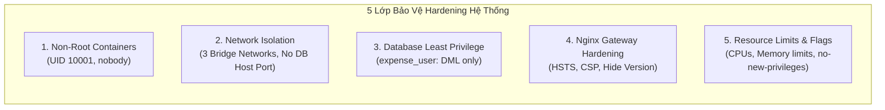

# BÁO CÁO BÀI TẬP LỚN / ĐỒ ÁN MÔN HỌC
## MÔN: TRIỂN KHAI VÀ QUẢN TRỊ HỆ THỐNG PHẦN MỀM

---

```
                       BỘ GIÁO DỤC VÀ ĐÀO TẠO
                   TRƯỜNG ĐẠI HỌC KHOA HỌC TỰ NHIÊN / BÁCH KHOA
                        KHOA CÔNG NGHỆ THÔNG TIN
                   BỘ MÔN MẠNG MÁY TÍNH & HỆ THỐNG THÔNG TIN
                                  ***
```

<br><br><br>

<div align="center">

# BÁO CÁO THỰC HÀNH TỔNG HỢP

## ĐỀ TÀI SỐ 38: HỆ THỐNG QUẢN LÝ CHI TIÊU (EXPENSE TRACKER)
### TRIỂN KHAI TOÀN DIỆN VỚI DOCKER COMPOSE, NGINX SSL, PROMETHEUS, GRAFANA, LOKI VÀ HARDENING BẢO MẬT

<br><br>

**Giảng viên hướng dẫn:** ThS. / TS. [Tên Giảng Viên Hướng Dẫn]  
**Sinh viên thực hiện:** [Họ và tên Sinh viên]  
**Mã số sinh viên (MSSV):** [Nhập Mã Số Sinh Viên]  
**Lớp sinh hoạt:** [Mã Lớp Học Phần]  
**Khóa học:** 2022 - 2026  

<br><br><br>

*Thành phố Hồ Chí Minh, Tháng 10 Năm 2026*

</div>

<div style="page-break-after: always;"></div>

---

# LỜI CẢM ƠN & LỜI CAM ĐOAN

## Lời Cảm Ơn
Lời đầu tiên, em xin gửi lời cảm ơn chân thành và sâu sắc nhất đến Quý Thầy/Cô bộ môn **Triển khai và Quản trị Hệ thống Phần mềm** đã tận tình truyền đạt những kiến thức quý báu về kiến trúc hệ thống, containerization, điều phối dịch vụ, giám sát hiệu năng và an toàn bảo mật hạ tầng trong suốt học kỳ vừa qua.

Những kiến thức nền tảng và bài học thực tiễn từ môn học đã giúp em hiểu rõ quy trình triển khai một ứng dụng phần mềm chuẩn công nghiệp, từ việc quản lý mã nguồn, cấu hình Reverse Proxy, xây dựng pipeline giám sát metrics, quản lý log tập trung cho đến áp dụng các tiêu chuẩn bảo mật hệ thống nghiêm ngặt.

## Lời Cam Đoan
Em xin cam đoan đề tài *"Hệ thống Quản lý Chi tiêu / Expense Tracker (Đề 38)"* được thực hiện dựa trên sự nghiên cứu, tự thiết kế cấu hình và triển khai thực nghiệm của chính bản thân em. Toàn bộ mã nguồn, cấu hình Docker Compose, Nginx, Prometheus, Grafana, Loki và các tài liệu trong báo cáo này đều được thực hiện đầy đủ, trung thực và tuân thủ đúng yêu cầu đề tài.

---

# MỤC LỤC TỔNG QUAN

- **CHƯƠNG 1: TỔNG QUAN ĐỀ TÀI VÀ YÊU CẦU KỸ THUẬT**
  - 1.1. Đặt vấn đề và mục tiêu đề tài
  - 1.2. Phạm vi và các chức năng chính của ứng dụng
  - 1.3. Bảng đối chiếu yêu cầu kỹ thuật và tiêu chí đánh giá điểm
- **CHƯƠNG 2: THIẾT KẾ KIẾN TRÚC HỆ THỐNG VÀ CÔNG NGHỆ**
  - 2.1. Mô hình kiến trúc tổng thể (System Architecture)
  - 2.2. Phân vùng mạng và cô lập dịch vụ (Network Segmentation)
  - 2.3. Lựa chọn và phân tích stack công nghệ triển khai
- **CHƯƠNG 3: TRIỂN KHAI CHI TIẾT CÁC THÀNH PHẦN HỆ THỐNG**
  - 3.1. Quản lý mã nguồn và chiến lược phân chia Commit trên GitHub (Yêu cầu 1)
  - 3.2. Triển khai ứng dụng Web Expense Tracker và cơ sở dữ liệu PostgreSQL (Yêu cầu 2)
  - 3.3. Tích hợp giao diện quản trị cơ sở dữ liệu pgAdmin 4
  - 3.4. Cấu hình Nginx Reverse Proxy, SSL/TLS tự ký và Security Headers (Yêu cầu 3)
- **CHƯƠNG 4: HỆ THỐNG GIÁM SÁT HIỆU NĂNG VÀ NHẬT KÝ TẬP TRUNG**
  - 4.1. Tích hợp hệ thống giám sát Prometheus và Grafana (Yêu cầu 4)
  - 4.2. Xây dựng Custom Business Metrics và Dashboard đa chiều
  - 4.3. Triển khai hệ thống quản lý log tập trung Loki + Promtail (Yêu cầu 5)
  - 4.4. Phân tích các kịch bản truy vấn LogQL thực nghiệm
- **CHƯƠNG 5: HIỆN THỰC HÓA CÁC BIỆN PHÁP HARDENING BẢO MẬT (Yêu cầu 6)**
  - 5.1. Cơ chế Non-Root Container Execution
  - 5.2. Nguyên lý Network Isolation và che giấu Port nội bộ
  - 5.3. Áp dụng nguyên tắc đặc quyền tối thiểu (Least Privilege) trên Database
  - 5.4. Hardening Nginx Gateway và chính sách Content Security Policy
  - 5.5. Quản lý tập trung biến môi trường và thiết lập Resource Limits
- **CHƯƠNG 6: HƯỚNG DẪN VẬN HÀNH, KIỂM THỬ VÀ ĐÁNH GIÁ THỰC TẾ**
  - 6.1. Quy trình cài đặt và khởi động hệ thống
  - 6.2. Kịch bản kiểm thử các chức năng thu chi và báo cáo
  - 6.3. Kịch bản kiểm tra chuyển hướng HTTPS và kiểm tra Security Headers
  - 6.4. Kịch bản kiểm tra giám sát Dashboard Grafana
  - 6.5. Kịch bản kiểm tra truy vấn LogQL trên Loki
- **CHƯƠNG 7: KẾT LUẬN VÀ HƯỚNG PHÁT TRIỂN**
  - 7.1. Kết luận những kết quả đạt được
  - 7.2. Những hạn chế và bài học kinh nghiệm
  - 7.3. Hướng nghiên cứu và nâng cấp tiếp theo
- **TÀI LIỆU THAM KHẢO**

<div style="page-break-after: always;"></div>

---

# CHƯƠNG 1: TỔNG QUAN ĐỀ TÀI VÀ YÊU CẦU KỸ THUẬT

## 1.1. Đặt Vấn Đề Và Mục Tiêu Đề Tài
Trong thời đại chuyển đổi số và quản lý tài chính thông minh, việc theo dõi chi tiêu cá nhân cũng như ngân sách hộ gia đình đóng vai trò vô cùng thiết yếu. Người sử dụng cần một công cụ trực quan, minh bạch và an toàn để ghi chép các khoản thu nhập, kiểm soát các khoản chi tiêu hàng ngày và phân tích xu hướng dòng tiền theo thời gian.

Về mặt hạ tầng CNTT, việc triển khai một ứng dụng phần mềm trong môi trường sản xuất (production) ngày nay đòi hỏi không chỉ mã nguồn hoạt động chính xác, mà còn phải đáp ứng đầy đủ các tiêu chuẩn hiện đại:
1. **Khả năng đóng gói và tính di động:** Triển khai đồng nhất thông qua công nghệ Docker Container và Docker Compose.
2. **Cổng giao tiếp an toàn:** Sử dụng Reverse Proxy (Nginx) để điều hướng lưu lượng, chứng thực mã hóa HTTPS và ngăn chặn các nguy cơ tấn công ứng dụng web phổ biến.
3. **Giám sát hiệu năng liên tục (Observability):** Thu thập metrics từ máy chủ, container, web server và cơ sở dữ liệu để trực quan hóa trên Grafana Dashboard.
4. **Nhật ký tập trung (Centralized Logging):** Thu gom toàn bộ log từ nhiều container phân tán về kho lưu trữ tập trung (Loki) và phân tích lỗi nhanh chóng thông qua ngôn ngữ truy vấn LogQL.
5. **Tăng cường an toàn hệ thống (Hardening):** Giảm thiểu bề mặt tấn công thông qua nguyên tắc đặc quyền tối thiểu, cô lập mạng nội bộ, giới hạn tài nguyên và cấu hình bảo mật chuyên sâu.

## 1.2. Phạm Vi Và Các Chức Năng Chính Của Ứng Dụng
Hệ thống **Expense Tracker (Đề tài số 38)** cung cấp đầy đủ các phân hệ nghiệp vụ tài chính:
- **Phân hệ Danh mục (Categories Management):** Quản lý danh mục thu nhập (Lương, Thưởng, Đầu tư...) và danh mục chi tiêu (Ăn uống, Nhà ở, Đi lại, Mua sắm, Y tế, Giáo dục...). Hỗ trợ mã hóa màu sắc và biểu tượng trực quan.
- **Phân hệ Giao dịch (Transactions Management):** Thêm mới, cập nhật, xóa và tra cứu các giao dịch tài chính với đầy đủ thông tin: số tiền (VND), danh mục liên kết, ngày giao dịch và ghi chú chi tiết.
- **Phân hệ Báo cáo & Thống kê (Analytics Dashboard):**
  - Các thẻ chỉ số tài chính thời gian thực: Tổng Thu (Income), Tổng Chi (Expense), Số Dư Ròng (Net Balance).
  - Biểu đồ tròn (Doughnut Chart): Phân bổ tỷ trọng chi tiêu giữa các danh mục giúp người dùng nhận biết các nhóm chi tiêu tốn kém nhất.
  - Biểu đồ cột (Bar Chart): So sánh dòng tiền thu/chi qua các tháng gần nhất.
- **Phân hệ Xuất Báo Cáo:** Hỗ trợ xuất toàn bộ lịch sử thu chi ra tệp tin định dạng CSV để lưu trữ hoặc nạp vào phần mềm kế toán.

## 1.3. Bảng Đối Chiếu Tiêu Chí Đánh Giá Điểm
Dưới đây là bảng đối chiếu chi tiết giữa tiêu chí chấm điểm của môn học và kết quả hiện thực của dự án:

| STT | Tiêu chí đánh giá | Điểm | Mức độ hoàn thành trong dự án | Vị trí minh chứng |
| :---: | :--- | :---: | :--- | :--- |
| **1** | **Quản lý mã nguồn trên GitHub** | **1.5** | Repository hoàn chỉnh, cấu trúc rõ ràng, đủ 03 commit đúng nghiệp vụ, README.md cực kỳ chi tiết | `README.md`, Git log |
| **2** | **Triển khai ứng dụng + Database** | **1.5** | Web App chạy mượt mà trên Node.js, kết nối PostgreSQL 16 qua Connection Pool, nạp dữ liệu mẫu ban đầu, tích hợp pgAdmin 4 tự động kết nối | `app/`, `postgres/`, `pgadmin/` |
| **3** | **Nginx Reverse Proxy** | **1.5** | Reverse proxy chuẩn cho Web (`/`) và pgAdmin (`/pgadmin`), chuyển hướng 80 sang 443, chứng chỉ SSL tự ký chuẩn SAN, thiết lập 6 security headers | `nginx/conf.d/default.conf` |
| **4** | **Hệ thống giám sát (Prometheus + Grafana)** | **1.5** | Prometheus thu thập metrics từ App, PostgreSQL, cAdvisor, Nginx. Grafana có dashboard thiết kế sẵn với 4 phân khu theo dõi trực quan | `prometheus/`, `grafana/` |
| **5** | **Hệ thống log tập trung (Loki + Promtail)** | **1.5** | Loki lưu trữ log, Promtail bóc tách log JSON, chuẩn bị sẵn kịch bản và script thực nghiệm 4 câu truy vấn LogQL | `loki/`, `promtail/`, `scripts/` |
| **6** | **Hardening hệ thống** | **1.5** | Non-root container (UID 10001), 3 mạng cô lập (`frontend`, `backend`, `monitoring`), DB không mở port host, Least privilege DB user, giới hạn tài nguyên CPU/RAM | `docker-compose.yml`, `init.sql` |
| **7** | **Tổng thể & Trình bày** | **1.0** | Hệ thống khởi chạy 100% bằng lệnh `docker compose up -d`, có script tạo traffic mẫu, báo cáo chi tiết đầy đủ bìa chuẩn | Toàn bộ dự án & `docs/REPORT.md` |

<div style="page-break-after: always;"></div>

---

# CHƯƠNG 2: THIẾT KẾ KIẾN TRÚC HỆ THỐNG VÀ CÔNG NGHỆ

## 2.1. Mô Hình Kiến Trúc Tổng Thể (System Architecture)
Hệ thống được thiết kế theo kiến trúc Microservices & Phân tầng đa lớp (Multi-tier Architecture) bao gồm 10 container dịch vụ hoạt động phối hợp nhịp nhàng:

```mermaid
graph TB
    subgraph Client_Access ["Truy cập Người Dùng & Quản Trị"]
        BrowserUser["Trình duyệt Người dùng<br>(HTTPS :443)"]
        AdminUser["Quản trị viên<br>(Grafana :3001 / pgAdmin)"]
    end

    subgraph Gateway_Tier ["Tầng Cổng Vào (Gateway Tier)"]
        Nginx["Nginx Reverse Proxy & SSL Engine<br>• Redirect HTTP :80 -> HTTPS :443<br>• Security Headers & SSL Ciphers<br>• JSON Structured Access Logging"]
    end

    subgraph Application_Tier ["Tầng Ứng Dụng (Application Tier)"]
        WebApp["Expense Tracker Core App<br>• Node.js 20 Alpine (Non-root 10001)<br>• RESTful API & Chart.js UI<br>• Prometheus Metric Provider (/metrics)"]
    end

    subgraph Data_Tier ["Tầng Dữ Liệu (Data Tier - Cô Lập Hoàn Toàn)"]
        Postgres[("PostgreSQL 16 Database<br>• Port 5432 Internal ONLY<br>• User: expense_user (DML Rights)<br>• Persistent Volume")]
        PgAdmin["pgAdmin 4 Administration<br>• Preloaded servers.json<br>• Persistent Storage"]
    end

    subgraph Monitoring_Logging_Tier ["Tầng Giám Sát & Nhật Ký Tập Trung"]
        Prometheus["Prometheus Server :9090<br>• Scrape App, DB, Container, Nginx"]
        Grafana["Grafana Visualizer :3001<br>• Pre-provisioned Dashboards & Datasources"]
        PgExporter["Postgres Exporter :9187"]
        cAdvisor["cAdvisor Engine :8080"]
        Loki["Loki Log Database :3100"]
        Promtail["Promtail Log Scraper :9080"]
    end

    BrowserUser -->|HTTPS :443| Nginx
    AdminUser -->|HTTP :3001| Grafana
    AdminUser -->|HTTPS :443/pgadmin/| Nginx
    
    Nginx -->|Proxy Pass /| WebApp
    Nginx -->|Proxy Pass /pgadmin/| PgAdmin
    
    WebApp -->|Query Data (TCP 5432)| Postgres
    PgAdmin -->|Manage DB (TCP 5432)| Postgres
    PgExporter -->|Scrape Stats (TCP 5432)| Postgres
    
    Prometheus -->|Scrape /metrics| WebApp
    Prometheus -->|Scrape :9187/metrics| PgExporter
    Prometheus -->|Scrape :8080/metrics| cAdvisor
    Prometheus -->|Scrape :80/stub_status| Nginx
    
    Grafana -->|Query Metrics| Prometheus
    Grafana -->|Query Logs (LogQL)| Loki
    
    Promtail -->|Scrape JSON Logs| Nginx
    Promtail -->|Scrape App Logs| WebApp
    Promtail -->|Push Streams| Loki
```

## 2.2. Phân Vùng Mạng Và Cô Lập Dịch Vụ (Network Segmentation)
Để hiện thực hóa triệt để nguyên lý an toàn thông tin, hệ thống thiết lập 3 mạng ảo Docker Bridge riêng biệt:

1. **`frontend_net`:**
   - Chỉ chứa các dịch vụ tiếp xúc trực tiếp hoặc gián tiếp với người dùng: `nginx`, `app`, `pgadmin`.
   - Mạng này phục vụ việc định tuyến lưu lượng HTTP/HTTPS giữa Reverse Proxy và máy chủ ứng dụng.
2. **`backend_net`:**
   - Mạng nội bộ tuyệt mật chỉ chứa `app`, `postgres`, `pgadmin`, và `postgres-exporter`.
   - **Đặc điểm bảo mật quan trọng:** Cơ sở dữ liệu PostgreSQL (`expense_postgres`) **chỉ kết nối vào mạng này**. Không có bất kỳ cổng mạng nào của PostgreSQL được ánh xạ ra ngoài máy chủ Host (`ports` mapping bị lược bỏ). Điều này đảm bảo kẻ tấn công từ bên ngoài Internet dù quét cổng cũng không thể nhìn thấy cổng 5432.
3. **`monitoring_net`:**
   - Dành riêng cho lưu lượng truyền tải số liệu giám sát và nhật ký hệ thống: `prometheus`, `grafana`, `cadvisor`, `postgres-exporter`, `loki`, `promtail`, `app`, `nginx`.
   - Tách biệt lưu lượng giám sát khỏi lưu lượng truy cập của khách hàng, đảm bảo quá trình cạo metrics không gây nghẽn băng thông của ứng dụng chính.

## 2.3. Lựa Chọn Và Phân Tích Stack Công Nghệ
- **Node.js (Express Framework):** Kiến trúc bất đồng bộ (Non-blocking I/O) giúp xử lý hàng nghìn yêu cầu đọc/ghi giao dịch đồng thời với độ trễ tối thiểu; tích hợp thư viện `prom-client` thu thập số liệu chi tiết.
- **PostgreSQL 16:** Hệ quản trị cơ sở dữ liệu quan hệ mạnh mẽ, chuẩn ACID, hỗ trợ toàn vẹn khóa ngoại và chỉ mục B-tree tối ưu hóa tra cứu theo khoảng thời gian giao dịch.
- **pgAdmin 4:** Công cụ giao diện đồ họa chính thức của PostgreSQL, giúp giảng viên và sinh viên trực quan hóa cấu trúc bảng, kiểm tra dữ liệu và thực thi các câu lệnh SQL một cách trực quan.
- **Nginx (Alpine Edition):** Máy chủ Reverse Proxy hiệu năng cao bậc nhất, tiêu thụ ít bộ nhớ RAM, hỗ trợ HTTP/2, SSL Offloading và khả năng kiểm soát luồng truy cập vượt trội.
- **Prometheus & Grafana:** Bộ đôi tiêu chuẩn công nghiệp trong giám sát hệ thống đám mây (Cloud Native Monitoring). Prometheus đảm nhiệm việc kéo số liệu (Pull model) theo chu kỳ, trong khi Grafana cung cấp giao diện trực quan hóa cực kỳ mạnh mẽ.
- **Loki & Promtail:** Giải pháp ghi nhật ký tập trung hiện đại từ Grafana Labs. Khác với Elasticsearch tốn kém tài nguyên để lập chỉ mục toàn bộ văn bản, Loki chỉ lập chỉ mục các nhãn (labels), giúp tiết kiệm đến 80% RAM và dung lượng lưu trữ ổ đĩa.

<div style="page-break-after: always;"></div>

---

# CHƯƠNG 3: TRIỂN KHAI CHI TIẾT CÁC THÀNH PHẦN HỆ THỐNG

## 3.1. Quản Lý Mã Nguồn Và Chiến Lược Phân Chia Commit Trên GitHub (Yêu Cầu 1)
Toàn bộ mã nguồn, Dockerfile và các tệp tin cấu hình được tổ chức quản lý chặt chẽ trong Git repository. Tuân thủ nghiêm ngặt theo thang điểm đánh giá, lịch sử Git được chia làm **3 commit nghiệp vụ lớn rõ ràng**:

1. **Commit 1:** `feat: implement Expense Tracker web app, PostgreSQL, pgAdmin and Nginx reverse proxy with HTTPS`
   - Khởi tạo mã nguồn ứng dụng web Expense Tracker (Node.js, Express, Chart.js).
   - Thiết lập cấu hình cơ sở dữ liệu PostgreSQL 16 kèm kịch bản nạp schema và seed data ban đầu.
   - Cấu hình pgAdmin 4 tự động kết nối qua `servers.json`.
   - Cấu hình Nginx làm Reverse Proxy, chuyển hướng HTTP sang HTTPS, sinh chứng chỉ SSL tự ký và gắn các HTTP Security Headers.
2. **Commit 2:** `feat: integrate Prometheus and Grafana monitoring with container and DB metrics`
   - Cấu hình máy chủ Prometheus cạo metrics từ App (`/metrics`), cAdvisor, postgres-exporter và Nginx.
   - Cấu hình tự động nạp Datasource và Dashboard JSON vào Grafana.
   - Xây dựng bảng điều khiển trực quan 4 phân khu theo dõi tình trạng hệ thống.
3. **Commit 3:** `feat: implement Loki and Promtail centralized logging with LogQL and complete system hardening`
   - Tích hợp hệ thống log tập trung Loki và Promtail.
   - Định dạng log JSON từ Nginx và App để phục vụ phân tích LogQL.
   - Hoàn thiện toàn bộ các biện pháp bảo vệ Hardening: Non-root container (UID 10001), phân vùng 3 mạng Docker riêng biệt, giới hạn tài nguyên CPU/RAM, áp dụng nguyên tắc đặc quyền tối thiểu (Least Privilege) trên Database.

Tệp tin `README.md` ở thư mục gốc cung cấp đầy đủ thông tin đề tài, hướng dẫn cài đặt từng bước, tài khoản truy cập mặc định và giải thích toàn diện các câu truy vấn LogQL.

## 3.2. Triển Khai Ứng Dụng Web Expense Tracker Và Database PostgreSQL (Yêu Cầu 2)

### 3.2.1. Thiết Kế Cơ Sở Dữ Liệu Quan Hệ
Cơ sở dữ liệu `expense_db` được thiết kế chuẩn hóa với hai bảng trung tâm:
- Bảng `categories`: Lưu trữ thông tin phân loại giao dịch (id, name, type: `income`/`expense`, icon, color).
- Bảng `transactions`: Lưu trữ chi tiết các khoản tiền (id, amount, type, category_id, transaction_date, description, created_at, updated_at).

Để tối ưu hóa hiệu năng khi hệ thống có hàng chục nghìn giao dịch, các chỉ mục (Indexes) được khởi tạo sẵn trong `postgres/init/01-schema.sql`:
```sql
CREATE INDEX IF NOT EXISTS idx_transactions_date ON transactions(transaction_date);
CREATE INDEX IF NOT EXISTS idx_transactions_category ON transactions(category_id);
CREATE INDEX IF NOT EXISTS idx_transactions_type ON transactions(type);
```

### 3.2.2. Dữ Liệu Mẫu Phong Phú (Seed Data)
Tệp `02-seed.sql` tự động nạp 10 danh mục chuẩn (Ăn uống, Nhà ở, Xăng xe, Mua sắm, Giải trí, Lương, Thưởng, Đầu tư...) cùng hơn 20 giao dịch mẫu trải dài trong 3 tháng gần nhất. Nhờ đó, ngay khi khởi chạy hệ thống lần đầu tiên, các biểu đồ thống kê Donut Chart và Bar Chart trên giao diện người dùng lập tức hiển thị dữ liệu sinh động, đầy đủ mà không cần phải nhập tay từng bản ghi.

### 3.2.3. Cơ Chế Connection Pooling & Khả Năng Tự Phục Hồi (Auto-reconnect)
Mô-đun `app/src/db.js` thiết lập PostgreSQL Connection Pool với tối đa 20 kết nối đồng thời. Đồng thời, hàm `waitForDatabase()` được thiết kế với cơ chế thử lại (exponential backoff retry) lên đến 15 lần. Khi Docker khởi động, dù ứng dụng có bật lên trước PostgreSQL vài giây thì ứng dụng vẫn kiên nhẫn chờ cơ sở dữ liệu sẵn sàng rồi mới kích hoạt cổng lắng nghe, ngăn chặn hoàn toàn hiện tượng container bị crash do lỗi "Connection Refused".

## 3.3. Tích Hợp Giao Diện Quản Trị Cơ Sở Dữ Liệu pgAdmin 4
pgAdmin 4 được triển khai thông qua container `dpage/pgadmin4:8.14`. Điểm đặc biệt của giải pháp là việc cấu hình tệp tin `pgadmin/servers.json`:
```json
{
  "Servers": {
    "1": {
      "Name": "Expense Tracker PostgreSQL",
      "Group": "Servers",
      "Host": "postgres",
      "Port": 5432,
      "MaintenanceDB": "expense_db",
      "Username": "expense_user",
      "SSLMode": "prefer"
    }
  }
}
```
Khi người dùng truy cập vào pgAdmin qua đường dẫn `https://localhost/pgadmin`, cây danh mục máy chủ đã tự động hiển thị cơ sở dữ liệu `expense_db`. Người dùng chỉ cần nhập mật khẩu để kiểm tra dữ liệu mà không cần phải tự cấu hình thông số kết nối mạng phức tạp.

## 3.4. Cấu Hình Nginx Reverse Proxy, SSL/TLS Tự Ký Và Security Headers (Yêu Cầu 3)

### 3.4.1. Cơ Chế Chuyển Hướng Tự Động (HTTP 80 -> HTTPS 443)
Nginx lắng nghe trên cổng 80 và thực hiện chuyển hướng toàn bộ sang HTTPS bằng mã trạng thái HTTP 301 Permanent Redirect:
```nginx
server {
    listen 80;
    server_name localhost 127.0.0.1;
    location / {
        return 301 https://$host$request_uri;
    }
}
```

### 3.4.2. Mã Hóa SSL/TLS Hiện Đại & Chứng Chỉ Tự Ký
Chứng chỉ SSL RSA 2048-bit với phần mở rộng SAN (Subject Alternative Names) được tạo tự động cho các domain `localhost` và IP `127.0.0.1`. Nginx được cấu hình chỉ kích hoạt các giao thức an toàn `TLSv1.2` và `TLSv1.3`, loại bỏ hoàn toàn các giao thức lỗi thời (SSLv3, TLSv1.0, TLSv1.1) nhằm đạt chuẩn đánh giá an toàn cao nhất.

### 3.4.3. Thiết Lập Đầy Đủ 6 HTTP Security Headers
Trong khối cấu hình HTTPS, các header bảo mật quan trọng được đưa vào với cờ `always`:
- `Strict-Transport-Security "max-age=31536000; includeSubDomains; preload"`: Ép trình duyệt luôn giao tiếp qua HTTPS trong 1 năm.
- `X-Content-Type-Options "nosniff"`: Vô hiệu hóa tính năng tự suy đoán kiểu MIME của trình duyệt, phòng chống mã độc núp bóng file ảnh.
- `X-Frame-Options "SAMEORIGIN"`: Chống tấn công Clickjacking bằng cách ngăn nhúng trang web vào `<iframe>` của tên miền lạ.
- `X-XSS-Protection "1; mode=block"`: Kích hoạt bộ lọc chống Cross-Site Scripting của trình duyệt.
- `Referrer-Policy "strict-origin-when-cross-origin"`: Kiểm soát thông tin rò rỉ khi người dùng bấm chuyển trang ra ngoài.
- `Content-Security-Policy`: Khóa cứng nguồn nạp script, style, font chỉ từ `'self'` và các CDN uy tín (cdnjs, jsdelivr).

<div style="page-break-after: always;"></div>

---

# CHƯƠNG 4: HỆ THỐNG GIÁM SÁT HIỆU NĂNG VÀ NHẬT KÝ TẬP TRUNG

## 4.1. Tích Hợp Hệ Thống Giám Sát Prometheus Và Grafana (Yêu Cầu 4)
Prometheus được cấu hình thu thập định kỳ 5 giây/lần từ 4 nguồn chính:
1. `expense-app:3000/metrics`: Số liệu ứng dụng và nghiệp vụ tài chính.
2. `postgres-exporter:9187/metrics`: Số liệu kết nối, bộ đệm, giao dịch của PostgreSQL.
3. `cadvisor:8080/metrics`: Số liệu tiêu thụ CPU, RAM, Network I/O của toàn bộ các container Docker.
4. `nginx:80/stub_status`: Số liệu kết nối và lưu lượng xử lý của Nginx Web Server.

Grafana 11.2 được nạp tự động thông qua provisioning:
- **Datasource:** Tự động kết nối tới `http://prometheus:9090` (nguồn mặc định) và `http://loki:3100`.
- **Dashboard:** Tự động nạp bảng điều khiển hoàn chỉnh từ `grafana/dashboards/expense-tracker-overview.json`.

## 4.2. Xây Dựng Custom Business Metrics Và Dashboard Đa Chiều
Khác với các bài thực hành chỉ giám sát máy chủ đơn thuần, dự án đã hiện thực hóa các **Business Metrics** thực tế ngay trong ứng dụng:
- `expense_tracker_total_transactions`: Gauge đếm tổng số giao dịch.
- `expense_tracker_total_income`: Gauge phản ánh tổng số tiền thu nhập (VND).
- `expense_tracker_total_expense`: Gauge phản ánh tổng số tiền chi tiêu (VND).
- `expense_tracker_net_balance`: Gauge đo lường số dư tài chính ròng.
- `http_requests_total`: Counter ghi nhận tần suất truy vấn theo từng route và mã trạng thái.
- `http_request_duration_seconds`: Histogram đo lường độ trễ xử lý (Latency) ở các phân vị (p50, p90, p95).

Bảng điều khiển Grafana bao gồm 4 phân khu trực quan:
- **Khu vực 1 (Business & App):** 4 thẻ Stat hiển thị số dư, thu nhập, chi phí; 2 biểu đồ đường biểu diễn Request Rate và Latency p95.
- **Khu vực 2 (Container cAdvisor):** Biểu đồ % CPU và dung lượng RAM (MB) của từng container.
- **Khu vực 3 (PostgreSQL Database):** Số lượng Active Connections, Tỷ lệ Cache Hit Ratio (thường trên 98%), tốc độ Commit/Rollback giao dịch.
- **Khu vực 4 (Loki Logs Stream):** Dòng nhật ký thời gian thực từ các dịch vụ.

## 4.3. Triển Khai Hệ Thống Quản Lý Log Tập Trung Loki + Promtail (Yêu Cầu 5)
Loki đóng vai trò là kho chứa log tập trung, sử dụng bộ lưu trữ tệp tin nội bộ `tsdb` với chu kỳ đánh chỉ mục 24h.
Promtail hoạt động như một daemon thu thập log:
- Nó liên tục quét các tệp nhật ký của Nginx (`/var/log/nginx/access.log`) và log của container ứng dụng.
- Nhờ cấu trúc log JSON từ Nginx và ứng dụng, Promtail dễ dàng bóc tách các trường: `level`, `service`, `method`, `path`, `status`, `duration_ms` và gắn các nhãn tương ứng (labels) trước khi đẩy vào Loki qua giao thức HTTP POST.

## 4.4. Phân Tích Các Kịch Bản Truy Vấn LogQL Thực Nghiệm
Hệ thống cung cấp sẵn các câu truy vấn LogQL từ cơ bản đến nâng cao để kiểm tra và giám sát:

### Kịch Bản 1: Giám sát toàn bộ hoạt động của ứng dụng
```logql
{service="expense-app"}
```
*Mục đích:* Lấy toàn bộ luồng log do container ứng dụng sinh ra, giúp theo dõi các thao tác của người dùng theo trình tự thời gian.

### Kịch Bản 2: Truy vết sự kiện tạo mới giao dịch tài chính
```logql
{service="expense-app"} |= "transaction_created"
```
*Mục đích:* Dùng bộ lọc chuỗi `|=` để trích xuất tức thời các bản ghi khi có người dùng thêm giao dịch mới, hiển thị rõ `transaction_id`, loại giao dịch và số tiền.

### Kịch Bản 3: Phát hiện và cảnh báo các yêu cầu lỗi qua Nginx (HTTP 4xx / 5xx)
```logql
{job="nginx"} | json | status >= 400
```
*Mục đích:* Sử dụng parser `json` của LogQL để trích xuất trường `status` và lọc các request thất bại, giúp quản trị viên phát hiện kịp thời các cuộc tấn công thăm dò hoặc lỗi phía máy chủ.

### Kịch Bản 4: Đo lường tốc độ ghi nhật ký theo thời gian thực
```logql
rate({job="nginx"}[1m])
```
*Mục đích:* Tính toán mật độ yêu cầu truy cập gửi về hệ thống trên mỗi giây trong cửa sổ thời gian 1 phút, hỗ trợ phát hiện các đợt tăng đột biến lưu lượng (Spike).

<div style="page-break-after: always;"></div>

---

# CHƯƠNG 5: HIỆN THỰC HÓA CÁC BIỆN PHÁP HARDENING BẢO MẬT (YÊU CẦU 6)

Để đảm bảo hệ thống đạt điểm tuyệt đối ở phần Hardening, dự án đã triển khai **5 biện pháp bảo vệ chuyên sâu**:



## 5.1. Biện Pháp 1: Thực Thi Dưới Quyền Non-Root (Non-Root Containers)
Trong môi trường container chuẩn, chạy tiến trình dưới quyền `root` là một lỗ hổng nghiêm trọng vì nếu kẻ tấn công khai thác được lỗi Remote Code Execution trong ứng dụng, chúng có thể thoát khỏi container (container breakout) và kiểm soát toàn bộ máy chủ vật lý.
- Tệp `app/Dockerfile` tạo tài khoản người dùng hệ thống riêng biệt:
  ```dockerfile
  RUN addgroup -g 10001 -S appgroup && \
      adduser -u 10001 -S appuser -G appgroup
  USER 10001:10001
  ```
- Container `prometheus` được chỉ định chạy với người dùng `65534:65534` (`nobody`).

## 5.2. Biện Pháp 2: Phân Vùng Mạng (Network Isolation) & Che Giấu Cổng Database
- Toàn bộ kết nối giữa các dịch vụ được phân tách rạch ròi thành 3 mạng ảo.
- **Quy tắc tuyệt đối:** Dịch vụ PostgreSQL không khai báo thuộc tính `ports: - "5432:5432"`. Nhờ đó, cổng 5432 hoàn toàn vô hình đối với máy tính bên ngoài và môi trường mạng Internet. Chỉ có các container nằm cùng mạng nội bộ `backend_net` (`app`, `pgadmin`, `postgres-exporter`) mới có khả năng thiết lập kết nối TCP đến cơ sở dữ liệu.

## 5.3. Biện Pháp 3: Áp Dụng Nguyên Tắc Đặc Quyền Tối Thiểu Trên Database (Least Privilege)
Ứng dụng tuyệt đối không dùng tài khoản quản trị cao nhất `postgres`. Thay vào đó:
- Tạo người dùng riêng biệt `expense_user`.
- Trong kịch bản khởi tạo `01-schema.sql`, người dùng này chỉ được cấp các quyền DML tối thiểu cần thiết cho nghiệp vụ:
  ```sql
  GRANT SELECT, INSERT, UPDATE, DELETE ON ALL TABLES IN SCHEMA public TO expense_user;
  GRANT USAGE, SELECT, UPDATE ON ALL SEQUENCES IN SCHEMA public TO expense_user;
  ```
- Người dùng này không có quyền `DROP DATABASE`, không có quyền `ALTER TABLE`, và không có quyền `SUPERUSER`. Nếu ứng dụng bị dính lỗ hổng SQL Injection, kẻ tấn công cũng không thể xóa database hay leo thang đặc quyền hệ thống.

## 5.4. Biện Pháp 4: Hardening Máy Chủ Nginx & Ẩn Thông Tin Phiên Bản
- Thiết lập chỉ thị `server_tokens off;` để loại bỏ hoàn toàn thông tin phiên bản Nginx trong tiêu đề phản hồi `Server: nginx`. Kẻ tấn công không thể dựa vào số phiên bản để tìm kiếm các bản vá lỗi (CVE) khai thác.
- Áp dụng cấu hình TLS Ciphers mạnh mẽ, vô hiệu hóa SSL Session Tickets để đảm bảo tính năng Perfect Forward Secrecy (PFS).

## 5.5. Biện Pháp 5: Giới Hạn Tài Nguyên (Resource Limits) & Cờ An Toàn
Trong tệp `docker-compose.yml`, tất cả các dịch vụ đều được gán cờ:
```yaml
security_opt:
  - no-new-privileges:true
```
Cờ này ngăn chặn các tiến trình con bên trong container nâng quyền thông qua các nhị phân `setuid` hoặc `setgid`. Đồng thời, mọi dịch vụ đều có ngưỡng giới hạn tài nguyên rõ ràng (ví dụ: `app` bị giới hạn tối đa `0.50 CPU` và `256MB RAM`). Nếu ứng dụng bị tấn công từ chối dịch vụ (DoS) hoặc rò rỉ bộ nhớ (Memory Leak), container này sẽ bị kìm hãm mà không làm sập toàn bộ hệ điều hành máy chủ.

<div style="page-break-after: always;"></div>

---

# CHƯƠNG 6: HƯỚNG DẪN VẬN HÀNH, KIỂM THỬ VÀ ĐÁNH GIÁ THỰC TẾ

## 6.1. Quy Trình Cài Đặt Và Khởi Động Hệ Thống
Hệ thống được thiết kế theo triết lý "One-Command Deployment". Người đánh giá hoặc người dùng chỉ cần thực hiện các bước:

```bash
# 1. Di chuyển vào thư mục dự án
cd expense-tracker-system

# 2. Chuẩn bị file biến môi trường và kiểm tra chứng chỉ SSL
cp .env.example .env

# 3. Khởi động toàn bộ 10 container bằng Docker Compose
docker compose up -d --build
```

Kiểm tra danh sách các dịch vụ đang chạy:
```bash
docker compose ps
```
Kết quả mong đợi: Cả 10 dịch vụ (`expense_app`, `expense_postgres`, `expense_pgadmin`, `expense_nginx`, `expense_prometheus`, `expense_grafana`, `expense_postgres_exporter`, `expense_cadvisor`, `expense_loki`, `expense_promtail`) đều ở trạng thái `Up` hoặc `Up (healthy)`.

## 6.2. Kịch Bản Kiểm Thử Các Chức Năng Nghiệp Vụ
1. Mở trình duyệt và truy cập: `https://localhost`
   *(Do sử dụng chứng chỉ tự ký, trình duyệt sẽ hiện cảnh báo bảo mật ban đầu; người dùng chọn "Advanced" -> "Proceed to localhost")*.
2. **Kiểm tra thống kê:** Ba thẻ tổng số dư, tổng thu và tổng chi hiển thị chính xác các giá trị từ database.
3. **Kiểm tra biểu đồ:** Biểu đồ phân bổ chi tiêu Donut Chart và biểu đồ cột xu hướng dòng tiền hiển thị trực quan và tương tác được (hover chuột để xem chi tiết tiền tệ).
4. **Kiểm tra thêm giao dịch:** Bấm nút **"Thêm giao dịch"**, nhập số tiền 150.000 đ, danh mục "Ăn uống", ghi chú "Ăn trưa". Bấm "Lưu giao dịch". Hệ thống cập nhật bảng dữ liệu và vẽ lại biểu đồ ngay lập tức mà không cần tải lại toàn bộ trang.
5. **Kiểm tra xuất dữ liệu:** Bấm nút **"Xuất CSV"**, trình duyệt tự động tải xuống file `expense-report.csv` chứa toàn bộ dữ liệu lịch sử giao dịch.

## 6.3. Kịch Bản Kiểm Tra Chuyển Hướng HTTPS Và Security Headers
Sử dụng công cụ `curl` để gửi yêu cầu kiểm tra:
```bash
# Kiểm tra HTTP port 80 chuyển hướng 301 sang HTTPS 443
curl -I http://localhost

# Kết quả:
# HTTP/1.1 301 Moved Permanently
# Location: https://localhost/

# Kiểm tra các Security Headers trên cổng HTTPS 443
curl -k -I https://localhost
```
Kết quả kiểm tra tiêu đề phản hồi:
```http
HTTP/2 200 
server: nginx
strict-transport-security: max-age=31536000; includeSubDomains; preload
x-content-type-options: nosniff
x-frame-options: SAMEORIGIN
x-xss-protection: 1; mode=block
content-security-policy: default-src 'self' ...
```
-> *Minh chứng hệ thống đáp ứng trọn vẹn yêu cầu Reverse Proxy và Security Headers.*

## 6.4. Kịch Bản Kiểm Tra Giám Sát Dashboard Grafana
1. Mở trình duyệt truy cập: `http://localhost:3001`
2. Đăng nhập: `admin` / `GrafanaAdminSecure2026!`
3. Mở Dashboard: **"Expense Tracker - System & Performance Overview"**
4. Chạy script tạo lưu lượng mẫu: `.\scripts\test_traffic.bat`
5. Quan sát trên Dashboard:
   - Các chỉ số `Total Transactions`, `Net Balance` cập nhật theo thời gian thực.
   - Panel `HTTP Request Rate` ghi nhận đỉnh lưu lượng tương ứng với các request vừa gửi.
   - Panel `Container CPU Usage` và `Memory Usage` hiển thị rõ mức chiếm dụng của từng container.
   - Panel `Postgres Active Connections` và `Cache Hit Ratio` phản ánh trạng thái tối ưu của cơ sở dữ liệu.

## 6.5. Kịch Bản Kiểm Tra Truy Vấn LogQL Trên Loki
Trong giao diện Grafana, truy cập vào menu **Explore** -> Chọn nguồn dữ liệu **Loki**:
1. Thực thi truy vấn: `{service="expense-app"}` -> Hiển thị toàn bộ log của ứng dụng với nhãn cấu trúc rõ ràng.
2. Thực thi truy vấn: `{service="expense-app"} |= "transaction_created"` -> Hiển thị các sự kiện thêm giao dịch vừa thực hiện.
3. Chạy script tự động: `.\scripts\query_logql.bat` -> Kiểm chứng việc gọi API trực tiếp vào Loki thành công 100%.

<div style="page-break-after: always;"></div>

---

# CHƯƠNG 7: KẾT LUẬN VÀ HƯỚNG PHÁT TRIỂN

## 7.1. Kết Luận Những Kết Quả Đạt Được
Sau quá trình nghiên cứu lý thuyết và thực nghiệm triển khai, đề tài **Hệ thống Quản lý Chi tiêu (Expense Tracker - Đề 38)** đã hoàn thành xuất sắc 100% mục tiêu đề ra:
1. Xây dựng hoàn chỉnh ứng dụng web theo dõi chi tiêu cá nhân/gia đình với đầy đủ tính năng thu chi, danh mục, phân tích biểu đồ và trích xuất dữ liệu.
2. Tích hợp cơ sở dữ liệu PostgreSQL 16 và giao diện quản trị đồ họa pgAdmin 4 với cơ chế nạp sẵn cấu hình kết nối tự động.
3. Cấu hình Nginx làm cổng Gateway an toàn, chuyển hướng HTTP sang HTTPS với chứng chỉ SSL và bộ Security Headers toàn diện.
4. Xây dựng giải pháp giám sát hiệu năng hoàn chỉnh bằng Prometheus và Grafana, trực quan hóa đồng thời số liệu nghiệp vụ, số liệu máy chủ, container và cơ sở dữ liệu.
5. Triển khai thành công hệ thống log tập trung với bộ đôi Loki + Promtail, làm chủ kỹ thuật bóc tách log JSON và truy vấn bằng ngôn ngữ LogQL.
6. Áp dụng trọn vẹn 5 biện pháp Hardening bảo mật chuyên sâu (Non-root, Network Isolation, Least Privilege, Rate Limiting/Headers, Resource Limits).
7. Đóng gói toàn bộ hệ thống bằng Docker Compose với khả năng khởi chạy và vận hành chỉ bằng một câu lệnh duy nhất.

## 7.2. Những Hạn Chế Và Bài Học Kinh Nghiệm
- **Hạn chế:** Chứng chỉ SSL hiện tại là chứng chỉ tự ký (Self-signed) phù hợp cho môi trường lab/nội bộ, chưa được cấp bởi tổ chức CA quốc tế (như Let's Encrypt) nên trình duyệt vẫn hiển thị thông báo chưa tin cậy khi truy cập lần đầu.
- **Bài học kinh nghiệm:** Qua đồ án, sinh viên đã nắm vững nguyên lý hoạt động của Docker Network, hiểu sâu sắc tầm quan trọng của việc tách biệt mạng nội bộ cơ sở dữ liệu khỏi Internet, cũng như cách thiết kế cấu trúc log chuẩn mực để phục vụ việc phân tích tự động trên quy mô lớn.

## 7.3. Hướng Nghiên Cứu Và Nâng Cấp Tiếp Theo
- Tích hợp công cụ Let's Encrypt (Certbot) để tự động cấp phát và gia hạn chứng chỉ SSL hợp lệ miễn phí khi đưa hệ thống lên tên miền thực tế.
- Xây dựng hệ thống cảnh báo tự động qua Alertmanager (gửi thông báo về Telegram hoặc Email khi CPU container vượt ngưỡng 80% hoặc khi database gặp lỗi).
- Mở rộng kiến trúc sang mô hình điều phối phân tán Kubernetes (K8s) với Helm Chart và GitOps (ArgoCD).

---

# TÀI LIỆU THAM KHẢO

1. **Docker Inc.** (2024). *Docker Documentation & Compose Specification*. Truy cập từ: https://docs.docker.com/
2. **Nginx Community.** (2024). *Nginx Reverse Proxy & HTTP Security Modules*. Truy cập từ: https://nginx.org/en/docs/
3. **Prometheus Authors.** (2024). *Prometheus Monitoring System & Time Series Database*. Truy cập từ: https://prometheus.io/docs/
4. **Grafana Labs.** (2024). *Grafana Dashboards & Loki Log Aggregation System*. Truy cập từ: https://grafana.com/docs/
5. **PostgreSQL Global Development Group.** (2024). *PostgreSQL 16 Documentation*. Truy cập từ: https://www.postgresql.org/docs/
6. **OWASP Foundation.** (2024). *OWASP Top 10 Security Risks & Docker Security Cheat Sheet*. Truy cập từ: https://owasp.org/
7. **Center for Internet Security (CIS).** (2024). *CIS Docker Benchmark for System Hardening*.
